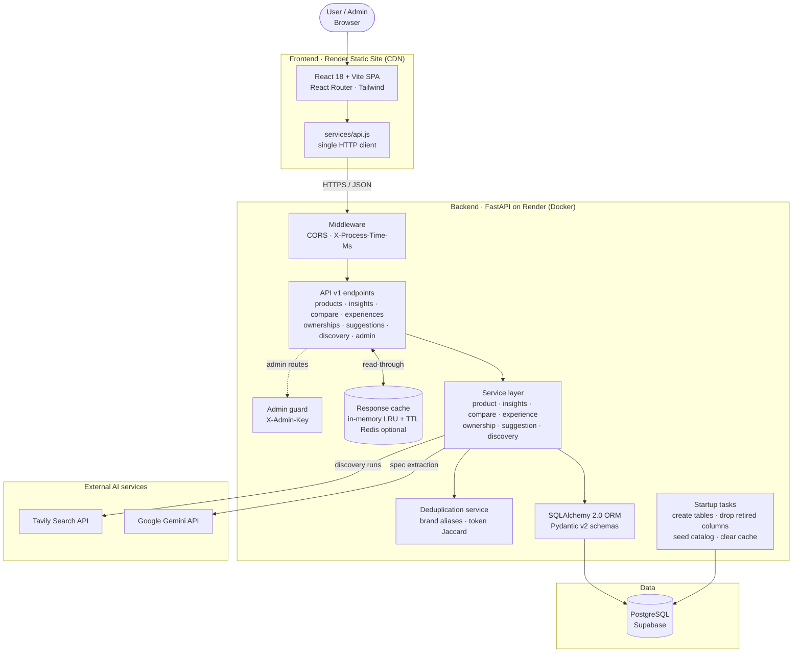
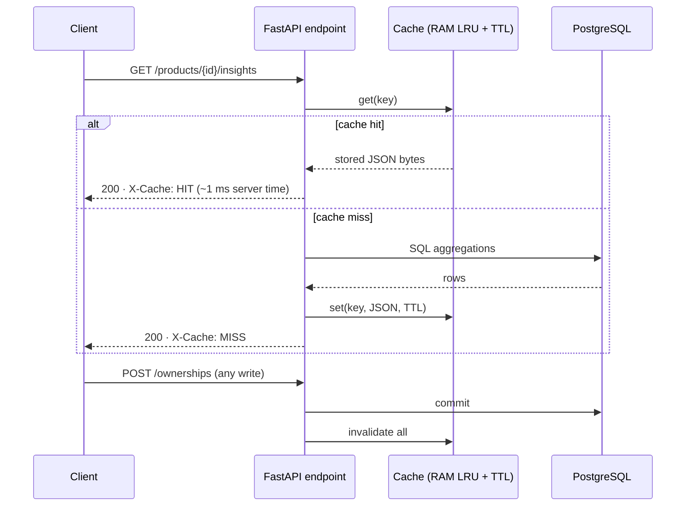

# WorthIt — Long-Term Smartphone Ownership Intelligence

> What actually happens after 3, 6, 12 and 24 months with a phone?
> Battery degradation, software stability, repairs, what owners really paid, and whether they would buy it again.


**API docs (live):** [worthit-backend-v4ob.onrender.com/api/v1/docs](https://worthit-backend-v4ob.onrender.com/api/v1/docs)
<!-- Live app: add your Render static-site URL here -->

---

## Table of Contents
- [Why WorthIt](#why-worthit)
- [Features](#features)
- [System Architecture](#system-architecture)
- [Response Caching](#response-caching)
- [Tech Stack](#tech-stack)
- [Project Structure](#project-structure)
- [Getting Started](#getting-started)
- [Environment Variables](#environment-variables)
- [Running Tests](#running-tests)
- [API Overview](#api-overview)
- [Deployment](#deployment)
- [Documentation](#documentation)

---

## Why WorthIt

Most reviews are written in the first week, when every phone is fast and every battery is healthy. Buyers actually want to know:

- Does the battery fall apart after a year?
- Did updates make it slower or buggier?
- What does a screen or battery repair really cost?
- Would owners buy it again, knowing what they know now?

WorthIt collects **longitudinal** reviews: the same owner reports at 3, 6, 12 and 24 months. Scores always show their sample size and a confidence tier, so a single early review can't pass for a verdict.

---

## Features

**For buyers**
- **Catalog** of 90+ phones across 16 brands, with search, brand filters and sorting by satisfaction or long-term owners.
- **Phone deep-dive:** category scores (battery, performance, software, camera), 12-month satisfaction, ownership timeline, issue breakdown, repair rate and median repair cost.
- **What owners actually paid:** average and median price paid, compared with the launch price of the *exact variant* each owner bought.
- **Sample-confidence banner** on every phone (Very low → High), based on owner count and 12-month+ owners.
- **Side-by-side comparison** of two phones, with auto-generated takeaways.

**For owners**
- **Share Experience** wizard: pick a phone and variant, add the price paid, rate it, and report issues and repairs.
- **Missing phone?** Suggest a model; duplicates are detected automatically.

**For admins** (protected by an admin key)
- **AI discovery pipeline:** Tavily web search → Gemini structured extraction → Jaccard deduplication → saved to the database.
- **Catalog Manager:** add phones by hand, **rename** any entry at any time, and delete wrong ones.
- **Suggestion queue:** correct a user's brand, model or variant *before* approving.
- **Cache panel:** hit/miss ratio, memory used, one-click flush.

---

## System Architecture



**How a request flows**
1. Every page calls the backend through one client, `frontend/src/services/api.js`.
2. FastAPI stamps server processing time on each response (`X-Process-Time-Ms`). Admin routes also check the `X-Admin-Key` header.
3. Read endpoints check the **response cache** first. On a hit, the stored JSON is returned without touching the database.
4. On a miss, the endpoint calls its **service** (each `X.py` endpoint has an `X_service.py`). The service queries PostgreSQL through SQLAlchemy, and the result is cached.
5. Any write clears the cache, so the next read is always fresh.

Not sure which backend file a page uses? See **[docs/frontend-backend-map.md](docs/frontend-backend-map.md)**.

---

## Response Caching

Read-heavy endpoints are served from a read-through cache that stores the **final JSON bytes**. A hit skips SQL, ORM object creation and Pydantic serialization.



| Mechanism | Purpose |
|---|---|
| **Write invalidation** | Any write clears the cache, so readers never see stale aggregates |
| **TTL** (default 600 s) | Safety net; expired entries are dropped on read |
| **LRU eviction** (default 64 MB budget) | Caps memory by bytes, so the cache can't exhaust the instance |
| **Pluggable backend** | `CACHE_BACKEND=memory` (default) or `redis` via `REDIS_URL` |

**Measured** with `backend/scripts/benchmark_cache.py`: 30 alternating pairs of requests per endpoint, one skipping the cache and one using it, medians reported.
Cache hits take **~1 ms** on the server. Product detail dropped from **67 ms → 0.9 ms**, and compare from **33 ms → 1.0 ms**.
*(This run was local, with the database on the same machine. A database across a network gains more.)*

---

## Tech Stack

| Layer | Technologies |
|---|---|
| Frontend | React 18, Vite 5, React Router 6, Tailwind CSS, Lucide icons |
| Backend | Python 3.12, FastAPI, Pydantic v2, SQLAlchemy 2.0, Uvicorn |
| Database | PostgreSQL (Supabase); SQLite for zero-config local runs and tests |
| Caching | In-process LRU + TTL cache; optional Redis |
| AI / Data | Tavily Search API, Google Gemini API (with offline mock providers) |
| Testing | Pytest, FastAPI TestClient, fakeredis |
| DevOps | Docker, Docker Compose, Render (backend web service + static site) |

---

## Project Structure

```
WorthIt/
├── backend/
│   ├── app/
│   │   ├── main.py                 # App entry: lifespan, CORS, timing middleware
│   │   ├── api/
│   │   │   ├── deps.py             # DB session, admin-key guard
│   │   │   └── v1/endpoints/       # products, insights, compare, experiences,
│   │   │                           # ownerships, suggestions, discovery, admin
│   │   ├── services/               # one service per endpoint (X.py -> X_service.py)
│   │   │   ├── product_service.py
│   │   │   ├── insights_service.py     # scores & confidence for ONE phone
│   │   │   ├── compare_service.py      # side-by-side for TWO phones
│   │   │   ├── experience_service.py   # owner reviews over time
│   │   │   ├── ownership_service.py
│   │   │   ├── suggestion_service.py
│   │   │   ├── discovery_service.py    # Tavily + Gemini pipeline
│   │   │   └── deduplication_service.py
│   │   ├── core/
│   │   │   ├── config.py           # settings from environment
│   │   │   ├── database.py         # engine & session
│   │   │   ├── cache.py            # response cache (memory / Redis)
│   │   │   └── schema_cleanup.py   # drops retired columns on startup
│   │   ├── models/                 # SQLAlchemy tables
│   │   ├── schemas/                # Pydantic request/response models
│   │   ├── providers/              # Tavily, Gemini, mock providers
│   │   └── seed/                   # catalog & demo data
│   ├── scripts/
│   │   ├── benchmark_cache.py      # before/after cache latency benchmark
│   │   └── drop_unused_columns.py  # preview/apply column cleanup
│   ├── tests/                      # 43 pytest tests
│   ├── Dockerfile
│   └── requirements.txt
├── frontend/
│   └── src/
│       ├── pages/                  # Home, ProductList, ProductDetail, Compare,
│       │                           # SubmitExperience, SuggestProduct, AdminDiscovery
│       ├── components/             # product/, forms/, admin/, compare/, common/
│       └── services/api.js         # all backend calls
├── docs/                           # architecture, database, API, discovery, file map
├── docker-compose.yml
└── CHANGELOG.html
```

---

## Getting Started

### Prerequisites
- Python 3.12+
- Node.js 18+
- *(optional)* Docker, and a PostgreSQL database such as Supabase. Without one, the backend uses SQLite.

### 1. Backend

```bash
cd backend
python -m venv venv
# Windows: .\venv\Scripts\activate    macOS/Linux: source venv/bin/activate
pip install -r requirements.txt

cp .env.example .env      # then edit values (see Environment Variables)

uvicorn app.main:app --reload --port 8000
```

On startup the app creates tables and seeds the phone catalog automatically.
For demo owners and reviews as well, run `python -m app.seed.seed_data` once.

- Swagger UI: http://127.0.0.1:8000/api/v1/docs
- Health check: http://127.0.0.1:8000/health

### 2. Frontend

```bash
cd frontend
npm install
echo "VITE_API_BASE_URL=http://127.0.0.1:8000/api/v1" > .env
npm run dev
```

The app runs at http://localhost:5173.

### 3. Docker Compose (Postgres + Redis + backend)

```bash
docker compose up --build
```

---

## Environment Variables

**Backend** (`backend/.env`)

| Variable | Required | Description |
|---|---|---|
| `DATABASE_URL` | yes (prod) | PostgreSQL URL. Any `postgres://` / `postgresql://` form works; defaults to local SQLite |
| `ADMIN_API_KEY` | yes (prod) | Secret for admin actions (add/rename/delete, approve suggestions). Generate one: `python -c "import secrets; print(secrets.token_urlsafe(32))"` |
| `ENVIRONMENT` | — | `production` makes admin routes refuse requests when `ADMIN_API_KEY` is unset |
| `TAVILY_API_KEY` | for discovery | Tavily web search; mock data is used if empty |
| `GEMINI_API_KEY` | for discovery | Gemini extraction; mock data is used if empty |
| `CACHE_BACKEND` | — | `auto` (default), `memory`, `redis` or `off` |
| `CACHE_TTL_SECONDS` | — | Cache entry lifetime, default `600` |
| `CACHE_MAX_MB` | — | RAM budget for the memory cache, default `64` |
| `REDIS_URL` | — | Only if you want Redis instead of RAM |
| `CORS_ORIGINS` | — | Comma-separated allowed origins, or `*` |

**Frontend** (`frontend/.env`)

| Variable | Description |
|---|---|
| `VITE_API_BASE_URL` | Backend base URL, e.g. `https://<your-backend>.onrender.com/api/v1` |

Never commit `.env` files; they are already in `.gitignore`.

---

## Running Tests

```bash
cd backend
pytest -q
```

The 43 tests cover:
- **Catalog and owners:** product CRUD, ownership and report flows, and longitudinal aggregation.
- **Insights:** sample-confidence tiers, and price-paid statistics including the variant checks.
- **Data quality:** deduplication, plus suggestion approval with edits and duplicate rejection.
- **Admin:** add, rename and delete, cascade deletes, and admin-key enforcement.
- **Cache:** every scenario runs against **both** the memory and Redis backends (via fakeredis), plus TTL, LRU and fail-open behaviour.

---

## API Overview

Base path: `/api/v1`. Full interactive docs are at `/api/v1/docs`.

| Method | Route | Description | Cached |
|---|---|---|:-:|
| GET | `/products` | Catalog with search, brand filter, sorting, pagination | ✓ |
| GET | `/products/brands` | Distinct brands | ✓ |
| GET | `/products/{id}` | Phone details and variants | ✓ |
| GET | `/products/{id}/insights` | Scores, confidence, issues, repairs, price paid | ✓ |
| GET | `/products/{id}/experiences` | Owner reviews (filter by months owned) | ✓ |
| GET | `/products/compare?product_a=&product_b=` | Side-by-side comparison | ✓ |
| POST | `/ownerships` | Register ownership + first review | |
| POST | `/ownerships/{id}/reports` | Add a follow-up review | |
| POST | `/product-suggestions` | Suggest a missing phone | |
| POST | `/product-suggestions/{id}/review` | 🔒 Approve (with edits), reject or mark duplicate | |
| POST | `/discovery/run` | 🔒 Run the AI discovery pipeline | |
| POST | `/admin/products` | 🔒 Add a phone | |
| PATCH | `/admin/products/{id}` | 🔒 Rename a phone | |
| DELETE | `/admin/products/{id}` | 🔒 Delete a phone | |
| GET / POST | `/admin/cache/stats` · `/admin/cache/flush` | 🔒 Cache stats / flush | |

🔒 = requires the `X-Admin-Key` header.

---

## Deployment

| Part | Platform |
|---|---|
| Frontend | Render **Static Site** (`npm run build`, publish `dist/`) |
| Backend | Render **Web Service** from `backend/Dockerfile` (single Uvicorn worker) |
| Database | Supabase PostgreSQL |

1. Create the Supabase project and copy its connection string.
2. Deploy the backend with `DATABASE_URL`, `ADMIN_API_KEY`, `ENVIRONMENT=production` and, optionally, the AI keys.
3. Deploy the frontend with `VITE_API_BASE_URL` pointing at the backend.
4. Check that `/health` returns `"status": "healthy"` and `"cache": "memory"`.

**Tips**
- Put the backend in the same region as the database, so every uncached query is faster.
- Render's free tier sleeps after about 15 minutes idle. An uptime pinger on `/health` avoids cold starts.

A step-by-step guide is in [DEPLOYMENT_GUIDE.md](DEPLOYMENT_GUIDE.md).

---

## Documentation

| Doc | Contents |
|---|---|
| [docs/frontend-backend-map.md](docs/frontend-backend-map.md) | Which page calls which endpoint and service |
| [docs/architecture.md](docs/architecture.md) | Architecture details |
| [docs/database.md](docs/database.md) | Database schema |
| [docs/api.md](docs/api.md) | REST API specification |
| [docs/product-discovery.md](docs/product-discovery.md) | AI discovery pipeline |
| [CHANGELOG.html](CHANGELOG.html) | Release notes and benchmarks |
